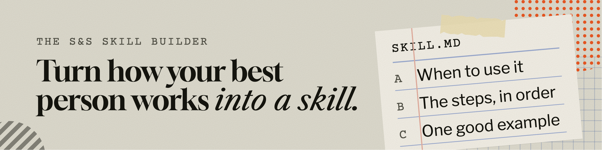

# Skill builder

This is the skill builder we use at Sprints & Sneakers. It turns the way your best person does a task into a skill your whole team can run with AI.

A skill is basically a folder with one text file in it, `SKILL.md`, that holds a process step by step with the thinking behind every step. Your senior writes it once. After that anyone on the team can ask for that task (or type `/weekly-report` in Claude Code) and the AI walks through the work the way the senior would.

This repo has two things:

| | What it is | For you if |
|---|---|---|
| [`skill-builder/`](skill-builder/) | A skill that interviews you about a task and writes, checks and tests the skill for you | You'd rather talk it through than write it |
| [`template/SKILL.md`](template/SKILL.md) | A fill-in-the-blanks skill | You want to write it yourself |

## Option 1: let the skill builder interview you

1. Install the `skill-builder` folder (see [Install](#install)).
2. Ask your senior to open Claude and say something like: "Turn the way I write our weekly report into a skill."
3. It interviews them in a few rounds of questions: how they do it, step by step and why, what good looks like and where juniors usually go wrong. It reads its summary back for them to correct, then writes the skill and tests it on a real request before handing it over.

## Option 2: fill in the template

1. Copy [`template/SKILL.md`](template/SKILL.md) into a folder with the same name as your skill, like `weekly-report/SKILL.md`.
2. Replace every `[FILL IN: ...]`. The text in each gap tells you what goes there.
3. Run the checker (below), then try the skill on a real task and fix what it gets wrong.

## Install

**Claude (the website and apps):** turn on code execution in Settings > Capabilities. Zip the skill folder, then go to Customize > Skills, press +, and choose Create skill > Upload a skill. Works on every plan, Free included.

**Claude Code:** copy the folder to `~/.claude/skills/`.

**Codex, GitHub Copilot, Cursor, Gemini CLI:** they read the same format. The folder locations for each are in [`skill-builder/references/install.md`](skill-builder/references/install.md).

**Your brand files:** a good skill points to your brand, voice and product files instead of copying them in. On claude.ai, put those files in a Project's knowledge and use the skill inside that Project. In Claude Code, keep them in the project folder.

## Check a skill

This checks a skill folder for the mistakes that stop it from loading or make it work worse. It needs Python 3. On a Mac, the first run may ask to install Apple's developer tools: click Install. Or skip all that and ask Claude (with code execution on) to run it for you.

```
python3 skill-builder/scripts/validate.py path/to/your-skill
```

## What makes a skill good

The full guide is in [`skill-builder/references/writing-guide.md`](skill-builder/references/writing-guide.md). If you read nothing else:

- **The description decides everything.** It's the only part the AI reads before it picks a skill. Write "Does X. Use when Y." with the words your team actually types.
- **Explain why, not only what.** The reasons behind each step are your senior's thinking, and that's the part a junior doesn't have.
- **Put one real example in it.** AI copies an example way better than it follows a list of rules.
- **Keep brand info out of the skill.** Point to your brand and audience files instead, so you update them in one place.
- **Keep a Gotchas list.** Every time the skill gets something wrong, add the mistake and the fix. That's how it gets better than the first version.

## Where this comes from

I built this from my own skill builder, the one I use to write skills for our marketing team, and from Anthropic's [skill-creator](https://github.com/anthropics/skills/tree/main/skills/skill-creator) (Apache 2.0). The rules follow the open [Agent Skills format](https://agentskills.io/specification) and Anthropic's [skill authoring best practices](https://platform.claude.com/docs/en/agents-and-tools/agent-skills/best-practices).

Free to use and adapt under the [Apache 2.0 licence](LICENSE).

Made by Zeb Visser.
